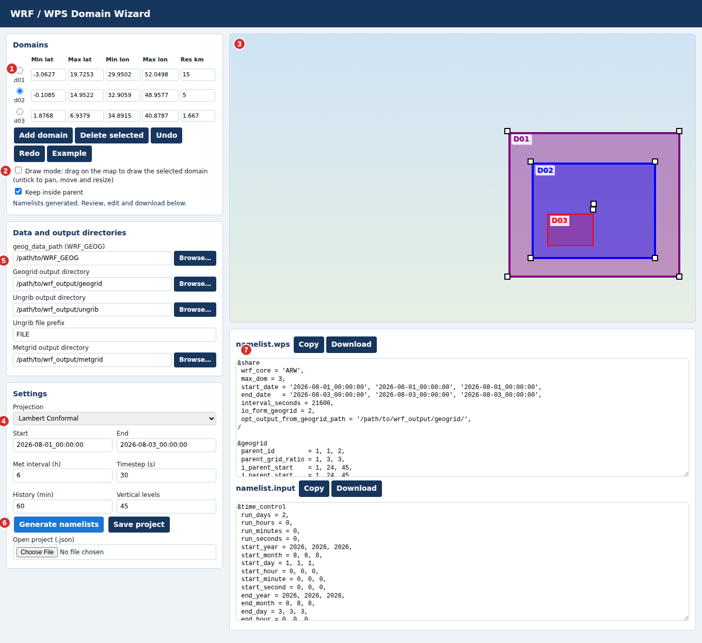

# WRF Domain Wizard: User Guide

This guide shows how to go from an empty map to `namelist.wps` and `namelist.input` using `index.html`.

*Numbers in the picture match the steps below. In this image the real map tiles are replaced by a plain background; in the app you see the Carto or ESRI basemap.*

## Before you start

- Open the live page, or open `index.html` in a browser (Chrome or Edge recommended).
- An internet connection is needed for the map and tiles.
- Click **Example** at any time to load a 3-domain sample and see how the tool behaves.

## Step 1. Draw the outer domain (d01)

1. Make sure **Draw mode** is ticked (area 2). The cursor becomes a crosshair.
2. On the map (area 3), press and hold the mouse button at one corner of your area, drag to the opposite corner, and release.
3. To place a corner outside the visible map, keep holding and move the pointer close to the map edge. The map scrolls by itself. You can also release outside the map.
4. The extents appear in the **Domains** table (area 1).

You can also type Min lat, Max lat, Min lon, Max lon and the resolution (km) directly into the table.

## Step 2. Add nested domains (d02, d03, ...)

1. Click **Add domain**. The new row gets one third of the previous resolution. Change it if you need another ratio.
2. Draw the nest with the mouse inside its parent. With **Keep inside parent** ticked, the box cannot leave the parent.
3. Repeat for each nest, up to 9 domains.

## Step 3. Adjust boxes

1. Untick **Draw mode** (area 2). Now dragging the map pans it.
2. Select a domain by clicking it on the map or choosing its radio button (area 1). It gets a thicker outline and white squares.
3. Drag the **centre square** to move it, or a **corner square** to resize it.
4. Use **Undo** and **Redo** to step back and forward.
5. Use **Delete selected** to remove the chosen domain. Later domains are renumbered.

The basemap switcher (top right of the map) changes between Carto Voyager, ESRI World Topo and ESRI World Imagery. Scroll to zoom.

## Step 4. Choose the projection

In **Settings** (area 4), pick Lambert Conformal, Mercator, Polar Stereographic or Latitude-Longitude. The reference point and true latitudes are computed from d01.

## Step 5. Set timing and run options

Fill in:

- **Start** and **End**, in `YYYY-MM-DD_HH:MM:SS` format.
- **Met interval (h)**, how often your input data arrives (for example 6).
- **Timestep (s)**, **History (min)** and **Vertical levels**.

## Step 6. Set data and output directories

In **Data and output directories** (area 5) enter:

| Box | Used for |
| --- | --- |
| geog_data_path | Your `WRF_GEOG` folder |
| Geogrid output directory | Where `geo_em` files are written |
| Ungrib output directory and file prefix | Intermediate files, written as `<directory>/<prefix>` |
| Metgrid output directory | Where `met_em` files are written |

**Browse…** opens a folder picker. Browsers do not reveal full paths, so only the folder name is inserted after the existing parent path. Check the start of each path afterwards.

## Step 7. Generate and export

1. Click **Generate namelists** (area 6).
2. Read the message under the table. A warning appears if a nest does not fit inside its parent.
3. Check `namelist.wps` and `namelist.input` in the editors (area 7). You can edit the text there.
4. Click **Copy** to copy a file's text, or **Download** to save it.
5. Use **Save project** to keep your domains and settings as a `.json` file, and **Open project** to load it later.

## Checking before a real run

- The grid sizes and parent start positions are estimated from the boxes you draw. Run `geogrid.exe` and plot the result to confirm the domains.
- `e_we - 1` and `e_sn - 1` of each nest must divide by its parent ratio. The tool aligns them, and warns about problems.
- The physics and dynamics values are general defaults. Adjust them for your case.

## Troubleshooting

| Problem | What to do |
| --- | --- |
| Map is blank | Check your internet connection, then hard-refresh with Ctrl+Shift+R. |
| Cannot drag the map | Untick Draw mode. |
| Cannot move or resize a box | Untick Draw mode and select the domain first. |
| "Cannot generate" message | Make sure every domain has numeric extents and a resolution, and that End is after Start. |
| Browse shows an upload prompt | Your browser lacks the folder picker. Nothing is uploaded; you can type the path instead. |
